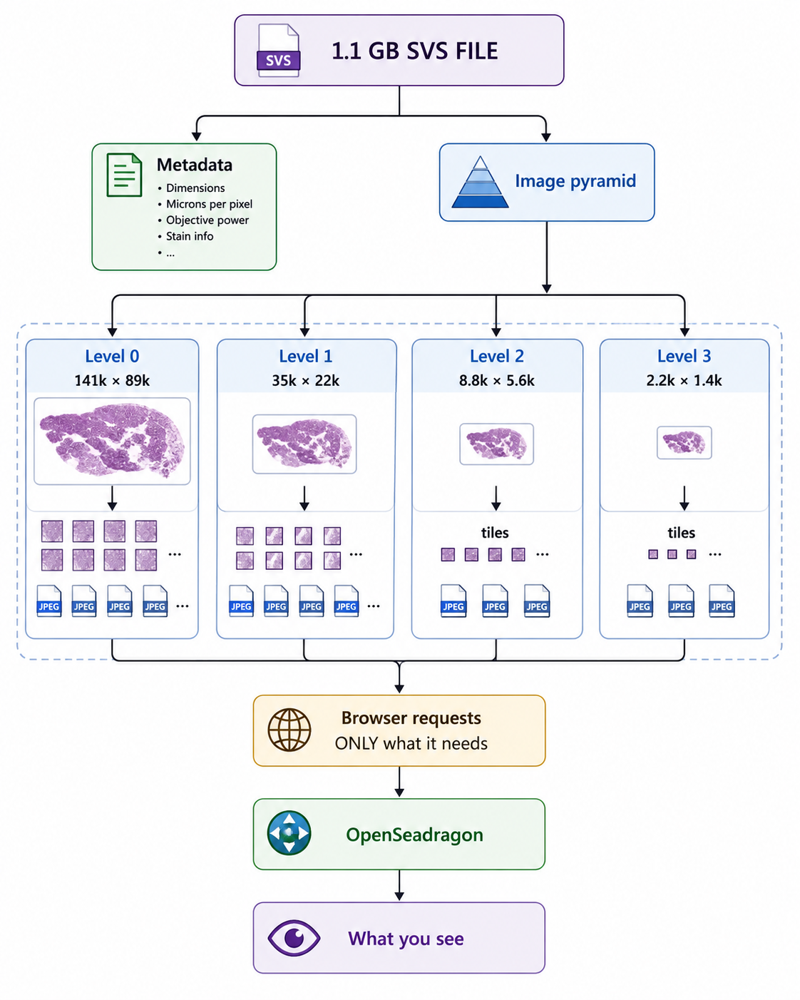

# Pathology Image Processing — TCGA BLCA FGFR3 Analysis Pipeline

**Paper:** Bannier et al. *Nature Communications* (2024) 15:10914 — "AI allows pre-screening of FGFR3 mutational status using routine histology slides of muscle-invasive bladder cancer"

**Target SVS:** `image/TCGA-FJ-A871-01Z-00-DX5.8F79D0A8-5DE6-4159-AA77-61DACB21E867.svs` (1.1 GB compressed, ~38 GB uncompressed, 141432×89585 px, 40× magnification, MPP 0.2525 µm)

---

## Quick Start

### Prerequisites

- Python 3.8+ (tested on 3.12)
- Modern browser (Chrome/Firefox) for SVS viewer
- ~15 GB RAM for full-pipeline processing (less for viewing)

### 1. Install Dependencies

```bash
# Full pipeline
pip install -r scripts/config/requirements.txt

# Viewer only (minimal)
pip install RangeHTTPServer tifffile imagecodecs Pillow
```

### 2. View the SVS Slide in Your Browser

```bash
# Start server from repo root
python3 -m RangeHTTPServer 8765

# Open in browser
# Main viewer:  http://localhost:8765/viewer.html
# Thumbnail:    http://localhost:8765/thumbnail.jpg
```

Or run in the background:

```bash
nohup python3 -m RangeHTTPServer 8765 > /tmp/svs_server.log 2>&1 &
echo "http://localhost:8765/viewer.html"
```

### 3. Run the Preprocessing Pipeline

```bash
# Quick test (first 10 tissue patches)
python scripts/preprocessing/preprocess_pipeline.py --max-tiles 10

# Full WSI (~15-20 min CPU)
python scripts/preprocessing/preprocess_pipeline.py --all
```

### 4. Fetch cBioPortal Metadata

```bash
# Single image
python scripts/analysis/fetch_cbioportal_data.py --image image/TCGA-FJ-A871-01Z-00-DX5.8F79D0A8-5DE6-4159-AA77-61DACB21E867.svs

# Batch (all slides from file list)
python scripts/analysis/fetch_cbioportal_data.py --file-list output/paper/paper_TCGA_all-features_457_slides__in_tcga_blca_slides_tsv.txt --outdir data --batch-size 30
```

### 5. Run FGFR3 Mutation Analysis

```bash
python scripts/analysis/analyze_fgfr3_mutations.py --data-dir data --out-dir output/mutation_analysis
```

### 6. Train the FGFR3MUT Model (Chowder MIL)

Reproduces the FGFR3MUT paper's pipeline (SVS tiles → H-optimus-0 features → Chowder MIL). See `docs/fgfr3mut_pipeline/training.md` for the full spec. All generated output (tiles, cached features, checkpoints) is written under `./results/`.

Both `train_fgfr3mut.py` and `infer_fgfr3mut.py` depend on Bannier et al.'s own paper code (the `fgfr3mut` Python package: Chowder model, bootstrap metrics, etc.). It isn't vendored in this repo's git history — on first run, either script automatically `git clone`s it from [github.com/PABannier/fgfr3mut](https://github.com/PABannier/fgfr3mut) into `scripts/fgfr3mut_training/fgfr3mut/` if it isn't already there (requires `git` to be installed). Later runs reuse that same clone.

```bash
pip install -r scripts/fgfr3mut_training/requirements.txt

# A. Tile each SVS (--save_pngs also writes the real tile images, not just tissue masks)
for S in image/*.svs; do
  python scripts/preprocessing/fgfr3mut_tile_wsi.py --svs_path "$S" \
    --out_dir ./results/tiles_out --tissue_detector otsu --device auto \
    --target_mpp 1.0 --tile_size 224 --min_tissue_fraction 0.60 \
    --max_tiles 5000 --seed 0 --save_pngs
done

# A2. Build the ground-truth labels from the cBioPortal metadata in data/
# labels.csv columns: slide,label   (slide = "<name>.svs", label 0=WT/1=MUT)
python scripts/analysis/make_labels_csv.py

# B. Embed tiles with H-optimus-0 + train the Chowder ensemble
python scripts/fgfr3mut_training/train_fgfr3mut.py \
  --tiles_root ./results/tiles_out --slides_dir ./image \
  --labels_csv ./results/labels.csv --epochs 30

# C. Smoke test (synthetic data, no SVS/GPU needed)
python scripts/fgfr3mut_training/train_fgfr3mut.py --smoke_test --out_dir /tmp/fgfr3_smoke --epochs 1
```

`--device` defaults to `auto` (GPU if available, else CPU) in both scripts. `--feat_dir`/`--out_dir` for the training script default to `./results/features_cache` and `./results/models_trained`.

### 7. Run Inference / Check Model Performance

Loads every checkpoint in `results/models_trained/`, ensembles their predictions (mean of `sigmoid(logit)` per slide), and computes **two** performance reports against `labels.csv`, both saved to disk (not just printed):

1. A simple fixed-threshold report: accuracy + confusion matrix at `--threshold` (default 0.5).
2. The **same metrics the FGFR3MUT paper itself reports** (Table 1 / Fig. 2), computed by reusing the paper's own `fgfr3mut/bootstrap.py:compute_ci_with_bootstrap()`: AUC, AP, Sensitivity, Specificity, PPV, NPV — each with a 95% bootstrap confidence interval (1000 resamples by default) — using an operating threshold chosen to hit a target sensitivity (default 92%, `--target_sens`) rather than a naive 0.5 cutoff. See the script's own top-of-file "WHICH METRICS, AND WHERE THEY COME FROM" section for the full explanation.

Reuses `train_fgfr3mut.py`'s own feature-loading code, so it's guaranteed to embed tiles the same way training did (and reuses the `results/features_cache/` cache instead of re-running H-optimus-0).

```bash
python scripts/fgfr3mut_training/infer_fgfr3mut.py \
  --tiles_root ./results/tiles_out --slides_dir ./image \
  --labels_csv ./results/labels.csv --n_extreme 40
```

`--n_extreme` **must match** whatever Chowder's `ExtremeLayer` was actually trained with — `train_fgfr3mut.py` auto-shrinks it (and prints `note: n_extreme reduced to X`) whenever a slide has fewer than `2*n_extreme` tiles; using the wrong value fails with a tensor "size mismatch" error.

Outputs: per-slide predictions to `./results/predictions.csv` (override with `--out_csv`), every metric above (both reports, plus the ROC operating point) as JSON to `./results/metrics.json` (override with `--metrics_out`), and an **ROC curve figure** to `./results/roc_curve.png` (override with `--roc_out`, or pass `--roc_out none` to skip it) — reproducing the paper's own Fig. 2a-c style (reversed 0-to-1 Specificity axis, AUC/NPV/PPV annotated at the target-sensitivity operating point). Pass `--n_bootstrap 0` to skip the paper-style bootstrap report (useful for a quick check, or when it's the tiny demo dataset in this repo — bootstrap CIs need dozens+ of slides to be meaningful).

---

## SVS Viewer — How It Works

The SVS file is a tiled TIFF pyramid. The viewer parses the TIFF header to learn tile locations, then fetches only visible tiles via HTTP Range requests (`206 Partial Content`). A typical view uses 10-20 tiles (~2-5 MB RAM) instead of the full 38 GB.

| Level        | Dimensions      | Downsample | Tiles   |
| ------------ | --------------- | ---------- | ------- |
| 0 (full)     | 141432 × 89585 | 1×        | 220,660 |
| 1            | 35358 × 22396  | 4×        | 13,912  |
| 2            | 8839 × 5599    | 16×       | 888     |
| 3 (overview) | 2209 × 1399    | 64×       | 60      |



### Troubleshooting

| Problem                                       | Fix                                                          |
| --------------------------------------------- | ------------------------------------------------------------ |
| `curl Range` returns `200` + `1.1 GB`   | You're using`http.server` — switch to `RangeHTTPServer` |
| Black viewer /`GeoTIFFTileSource not found` | Wait 2s, hard-refresh`Ctrl+Shift+R`, check CDN online      |
| `Address already in use`                    | `ss -tlnp \| grep 8765` → `kill <PID>` or use `8766`   |
| `imagecodecs` error on thumbnail            | `pip install imagecodecs`                                  |

---

## Repository Structure

```
Pathology_Image_Processing/
├── README.md                  # This file
├── viewer.html                # Interactive SVS viewer (OpenSeadragon)
├── favicon.svg                # Browser tab icon
├── todo.md                    # Open notes & findings
├── data/                      # Downloaded metadata & TCGA SVS files
│   ├── cbioportal_*.json      # cBioPortal API responses (mutations, expression, CNA)
│   ├── data_manifest.json     # 926-folder metadata manifest
│   ├── TCGA-*/                # 1,000+ TCGA SVS directories
├── image/                     # SVS slides + reference images
│   ├── TCGA-FJ-A871-*.svs     # Main slide (1.1 GB)
│   ├── TCGA-2F-A9KQ-*.svs     # Additional slides
│   └── svs_file_format.png    # SVS internal structure diagram
├── docs/
│   └── fgfr3mut_pipeline/
│       └── training.md        # FGFR3MUT training pipeline spec (paper vs. code)
├── results/                   # Generated FGFR3MUT training/inference output
│   ├── tiles_out/              # Per-slide tiles/, tile_masks/, coords.npy, metadata.json
│   ├── features_cache/         # Cached (N,1539) H-optimus-0 embeddings per slide
│   ├── models_trained/         # Trained Chowder checkpoints (model_*_ep.pt)
│   ├── labels.csv              # slide,label ground truth used for training/inference (auto-generated by make_labels_csv.py)
│   ├── predictions.csv         # infer_fgfr3mut.py output: slide,label,pred_prob,pred_label
│   ├── metrics.json            # infer_fgfr3mut.py output: AUC/accuracy/confusion matrix + paper-style AUC/AP/Se/Sp/PPV/NPV with bootstrap CIs
│   └── roc_curve.png           # infer_fgfr3mut.py output: ROC curve figure (paper Fig. 2a-c style)
├── scripts/                   # All processing scripts (organized)
│   ├── preprocessing/         # Image preprocessing pipeline
│   │   ├── preprocess_pipeline.py     # Main pipeline (tissue-only filtering)
│   │   ├── patch_normalization_pipeline.py  # Macenko normalization (raw+normalized)
│   │   ├── tile_extractor.py          # Overlapping tile extraction from WSI
│   │   ├── tissue_detector.py         # Tissue/glass/focus/stain quality check
│   │   ├── background_remover.py      # Binary tissue mask (Otsu + closing)
│   │   ├── noise_remover.py           # Gaussian + Median + Morphological opening
│   │   ├── color_normalizer.py        # Percentile color normalization
│   │   ├── macenko_normalizer.py      # Macenko H&E stain normalization (gold standard)
│   │   ├── config.yaml                # Pipeline configuration
│   │   └── test_tile.png              # Test image for preprocessing
│   ├── analysis/                # Data analysis & figure generation
│   │   ├── analyze_fgfr3_mutations.py  # FGFR3 prevalence, hotspots, VAF, expression
│   │   ├── fetch_cbioportal_data.py    # cBioPortal API data fetcher
│   │   └── make_labels_csv.py          # Auto-generates results/labels.csv (slide,label) from data/
│   ├── annotation/              # Mutant location annotation
│   │   └── annotate_mutant_locations.py  # Locate & annotate FGFR3 mutants in slides
│   ├── utils/
│   │   └── download_svs.sh      # Download TCGA SVS via GDC gdc-client
│   ├── config/
│   │   └── requirements.txt     # Python dependencies
│   ├── reproduce/               # FGFR3MUT paper reproduction scripts
│   │   ├── download.py          # Download HuggingFace FGFR3MUT features/checkpoints
│   │   ├── tiling.py            # Standalone tiling repro/comparison tool
│   │   └── heatmap.py           # Attention heatmap overlay (paper Fig.2e)
│   └── fgfr3mut_training/       # FGFR3MUT training + inference entry points
│       ├── train_fgfr3mut.py    # SVS tiles -> H-optimus-0 features -> Chowder MIL training
│       ├── infer_fgfr3mut.py    # Ensemble inference + AUC/accuracy/confusion matrix/ROC curve
│       ├── requirements.txt     # Training-specific Python dependencies
│       └── fgfr3mut/            # Bannier et al.'s own paper code (Chowder, bootstrap.py, run_inference.py) —
│                                 # git-ignored; auto-cloned from github.com/PABannier/fgfr3mut on first run
├── output/                    # All generated outputs
│   ├── mutation_analysis/     # Fig1-7 figures + report (FGFR3 cohort stats)
│   │   ├── fig1_prevalence.png ... fig7_histology_surrogates.png
│   │   ├── per_sample_table.csv, per_slide_table.csv
│   │   ├── cohort_FGFR3_all_records.csv
│   │   └── report.md
│   ├── mutant_locations/      # Mutant annotation outputs
│   │   ├── WHICH_IMAGES_ARE_MUTANT.csv
│   │   ├── MUT_list.txt / WT_list.txt
│   │   ├── annotated_TCGA-FJ-A871-*.png
│   │   └── GDC_fetch_MUT_images.sh
│   ├── misc/                  # Reference data & file lists
│   │   ├── tcga_blca_slides.tsv
│   │   ├── tcga_blca_file_names.txt / .csv
│   │   ├── cbioportal_summary_all.csv
│   │   └── README_cBioPortal.md
│   ├── preprocessed/          # Full pipeline output (tiles, masks, metadata)
│   └── patches/               # Macenko patch output (raw/normalized pairs)
└── .gitignore
```

---

## Script Catalog

### Preprocessing (`scripts/preprocessing/`)

#### `preprocess_pipeline.py` — Main Full Preprocessing Pipeline

Orchestrates all preprocessing steps: tile extraction → noise removal → background removal → tissue detection → color normalization. Filters aggressively — only keeps high-quality tissue tiles.

**Outputs:** `output/preprocessed/tiles/`, `output/preprocessed/masks/`, `output/preprocessed/metadata/`

```bash
# Quick test (first 10 tissue patches)
python scripts/preprocessing/preprocess_pipeline.py --max-tiles 10

# Full WSI (~15-20 min CPU)
python scripts/preprocessing/preprocess_pipeline.py --all

# Custom ROI (x=12544, y=896, w=5000, h=5000)
python scripts/preprocessing/preprocess_pipeline.py --roi 12544 896 5000 5000 --max-tiles 50

# Specify config file
python scripts/preprocessing/preprocess_pipeline.py --config scripts/preprocessing/config.yaml
```

#### `patch_normalization_pipeline.py` — Macenko Normalization Pipeline

Alternative approach: extract raw patches → Macenko normalize → save raw + normalized separately (1:1 pairing). No filtering — keeps all tiles. Ideal for stain-invariant deep learning.

**Outputs:** `output/patches/raw/`, `output/patches/normalized/`, `output/patches/metadata/`

```bash
# Quick test (first 10 patches)
python scripts/preprocessing/patch_normalization_pipeline.py --max-tiles 10

# Full WSI
python scripts/preprocessing/patch_normalization_pipeline.py --all

# Custom ROI
python scripts/preprocessing/patch_normalization_pipeline.py --roi 12544 896 5000 5000 --max-tiles 20

# Custom output directory
python scripts/preprocessing/patch_normalization_pipeline.py --output-dir ../output/pilot --max-tiles 50
```

#### `tile_extractor.py` — Tile Extraction

Extracts overlapping patches from Whole Slide Images using OpenSlide. Never loads the full image into memory. Configurable patch size, overlap, and stride.

#### `tissue_detector.py` — Tissue Detection

Identifies whether a tile contains valid tissue (not glass/background). Checks tissue percentage, focus quality (Laplacian), and staining quality (HSV).

#### `background_remover.py` — Background Removal

Creates a binary tissue mask separating tissue from glass background. Uses Grayscale Otsu + inversion + morphological closing.

#### `noise_remover.py` — Noise Removal

Applies Gaussian (k=3) → Median (k=3) → Morphological opening (disk=2) filters. Targets Gaussian sensor noise, salt-and-pepper noise, and debris.

#### `color_normalizer.py` — Percentile Color Normalization

Standardizes stain colors across tiles using per-channel percentile scaling (low=1, high=99). Fast approximate method for batch color correction.

#### `macenko_normalizer.py` — Macenko H&E Stain Normalization

Gold-standard stain normalization using SVD of optical density covariance. Aligns hematoxylin/eosin vectors to a common reference. Based on Macenko et al., ISBI 2009.

---

### Analysis (`scripts/analysis/`)

#### `fetch_cbioportal_data.py` — cBioPortal Data Fetcher

Downloads clinically and genomically relevant cBioPortal records for TCGA slides: mutations, expression (RSEM), CNA, patient/sample clinical data. Supports three input modes: single image, directory scan, or file-list.

**Outputs:** `data/TCGA-*/cbioportal_*.json`

```bash
# Single image
python scripts/analysis/fetch_cbioportal_data.py --image image/TCGA-FJ-A871-01Z-00-DX5.8F79D0A8-5DE6-4159-AA77-61DACB21E867.svs

# Directory scan
python scripts/analysis/fetch_cbioportal_data.py --image-dir image/ --study blca_tcga_pan_can_atlas_2018

# File-list mode (batch)
python scripts/analysis/fetch_cbioportal_data.py --file-list output/misc/tcga_blca_file_names.txt --outdir data --batch-size 30

# Per-sample deep dive
python scripts/analysis/fetch_cbioportal_data.py --image image/TCGA-FJ-A871*.svs --outdir data
```

#### `make_labels_csv.py` — Auto-generate `results/labels.csv`

Builds the `slide,label` ground truth that `train_fgfr3mut.py` / `infer_fgfr3mut.py` consume, by joining the slide folders in `results/tiles_out/` against the FGFR3 status already downloaded into `data/` (label `1` = FGFR3 mutant, `0` = wild-type). Sources are consulted in order: `data/data_manifest.json` → `data/cbioportal_summary_all.csv` → the raw per-slide `data/<slide>/cbioportal_*_mutations.json` → the sample-level status of a sibling slide. Every slide's label and its source are printed; slides that cannot be labeled abort the run (use `--skip_unlabeled` to write the rest).

**Outputs:** `results/labels.csv`

```bash
# Regenerate results/labels.csv from results/tiles_out + data/
python scripts/analysis/make_labels_csv.py

# Preview without writing
python scripts/analysis/make_labels_csv.py --dry_run

# Custom paths
python scripts/analysis/make_labels_csv.py --tiles_root ./results/tiles_out --data_dir ./data --out_csv ./results/labels.csv
```

#### `analyze_fgfr3_mutations.py` — FGFR3 Mutation Analysis & Report

Scans cBioPortal data to compute FGFR3 prevalence, hotspot distribution, VAF, expression, stage/sex demographics, and tumor mutation burden. Generates 7 publication-quality figures + a layman-readable markdown report.

**Outputs:** `output/mutation_analysis/fig1-7_*.png`, `output/mutation_analysis/report.md`

```bash
# Full analysis
python scripts/analysis/analyze_fgfr3_mutations.py --data-dir data --out-dir output/mutation_analysis

# With higher DPI figures
python scripts/analysis/analyze_fgfr3_mutations.py --data-dir data --out-dir output/mutation_analysis --dpi 200
```

---

### Annotation (`scripts/annotation/`)

#### `annotate_mutant_locations.py` — Mutant Location Annotation

Lists which SVS files are FGFR3 mutant, explains why only one SVS is downloaded, and generates an annotated thumbnail + simulated heatmap for the mutant slide. Provides honest GDC download commands for missing MUT slides.

**Outputs:** `output/mutant_locations/WHICH_IMAGES_ARE_MUTANT.csv`, `MUT_list.txt`, `annotated_*.png`, `simulated_heatmap_*.png`

```bash
python scripts/annotation/annotate_mutant_locations.py --data-dir data --image-dir image --out-dir output/mutant_locations
```

---

### Utilities (`scripts/utils/`)

#### `download_svs.sh` — Download TCGA SVS via GDC

Downloads any TCGA SVS file by file name using the GDC gdc-client. Uses `output/misc/tcga_blca_slides.tsv` for file ID mapping.

```bash
# Download a single slide
./scripts/utils/download_svs.sh TCGA-2F-A9KQ-01Z-00-DX1.1C8CB2DD-5CC6-4E99-A0F9-32A0F598F5F9.svs

# Download multiple slides
./scripts/utils/download_svs.sh TCGA-FD-A3NA-01Z-00-DX1.2AD62CEE-0D76-4382-AE2E-9B7FCB1130D9.svs TCGA-FJ-A871-01Z-00-DX5.8F79D0A8-5DE6-4159-AA77-61DACB21E867.svs

# Download from stdin
echo "TCGA-....svs" | ./scripts/utils/download_svs.sh

# Custom output directory
./scripts/utils/download_svs.sh -d /tmp/my_images TCGA-....svs
```

---

## Configuration

All pipeline parameters are centralized in `scripts/preprocessing/config.yaml`:

```yaml
# Patch extraction
patch_extraction:
  patch_size: 1024
  overlap: 128
  stride: 896

# Noise reduction
noise_reduction:
  method: gaussian_median

# Background removal
background_removal:
  method: otsu

# Tissue detection
tissue_detection:
  min_tissue_percent: 5.0
  focus_method: laplacian
  focus_threshold: 50.0

# Color normalization
color_normalization:
  method: percentile
  low: 1
  high: 99

# Macenko normalization
macenko_normalization: {Io: 240, alpha: 1, beta: 0.15}
```

---

## Generated Outputs

### `output/mutation_analysis/`

| File                              | Content                                                   |
| --------------------------------- | --------------------------------------------------------- |
| `fig1_prevalence.png`           | FGFR3 mutation prevalence across cohorts                  |
| `fig2_hotspots.png`             | Hotspot mutation distribution (S249C, Y373C, G370C, etc.) |
| `fig3_expression.png`           | FGFR3 expression (RSEM) comparison MUT vs WT              |
| `fig4_stage.png`                | FGFR3 mutation rate by clinical stage                     |
| `fig5_vaf.png`                  | Variant allele frequency distribution                     |
| `fig6_clinical.png`             | Age/sex/TMB vs mutation status                            |
| `fig7_histology_surrogates.png` | Histological features distinguishing MUT vs WT            |
| `per_sample_table.csv`          | One row per unique sample (278 rows)                      |
| `per_slide_table.csv`           | One row per slide image (582 rows)                        |
| `cohort_FGFR3_all_records.csv`  | 68 FGFR3 variant records                                  |
| `report.md`                     | Human-readable analysis report                            |

### `output/mutant_locations/`

| File                                  | Content                                                 |
| ------------------------------------- | ------------------------------------------------------- |
| `WHICH_IMAGES_ARE_MUTANT.csv`       | Ground-truth label for every SVS (MUT/WT, hotspot, VAF) |
| `MUT_list.txt` / `WT_list.txt`    | Plain lists for scripting                               |
| `annotated_TCGA-FJ-A871-*.png`      | Real thumbnail stamped WT with explanation              |
| `simulated_heatmap_MUT_example.png` | Educational heatmap mimicking paper Fig.2e              |
| `GDC_fetch_MUT_images.sh`           | Commands to download missing MUT slides                 |

### `output/misc/`

| File                           | Content                                            |
| ------------------------------ | -------------------------------------------------- |
| `tcga_blca_slides.tsv`       | TCGA BLCA slide list (file_name + file_id mapping) |
| `tcga_blca_file_names.txt`   | Plain file-name list for batch fetching            |
| `tcga_blca_file_names.csv`   | CSV version of file-name list                      |
| `cbioportal_summary_all.csv` | Cohort-wide cBioPortal FGFR3 summary               |
| `README_cBioPortal.md`       | cBioPortal data documentation                      |

### `output/preprocessed/`

| Directory                          | Content                                             |
| ---------------------------------- | --------------------------------------------------- |
| `tiles/`                         | Preprocessed PNG tiles (tissue-only, noise-removed) |
| `masks/`                         | Binary tissue masks                                 |
| `metadata/tiles.json`            | Tile metadata with tissue%, focus, stain quality    |
| `metadata/processing_stats.json` | Processing statistics                               |

### `output/patches/`

| Directory               | Content                                           |
| ----------------------- | ------------------------------------------------- |
| `raw/`                | Raw extracted patches (before normalization)      |
| `normalized/`         | Macenko-normalized patches (1:1 pairing with raw) |
| `metadata/tiles.json` | Patch coordinates with raw/normalized filenames   |

---

## Paper Reference

> Bannier, P., et al. "AI allows pre-screening of FGFR3 mutational status using routine histology slides of muscle-invasive bladder cancer." *Nature Communications* 15, 10914 (2024).
> DOI: [10.1038/s41467-024-55331-6](https://doi.org/10.1038/s41467-024-55331-6)

---

*Generated for Pathology Image Processing Project — 2026*
